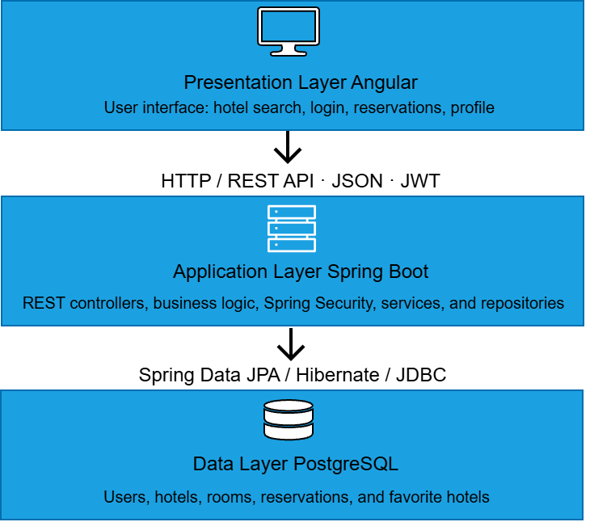
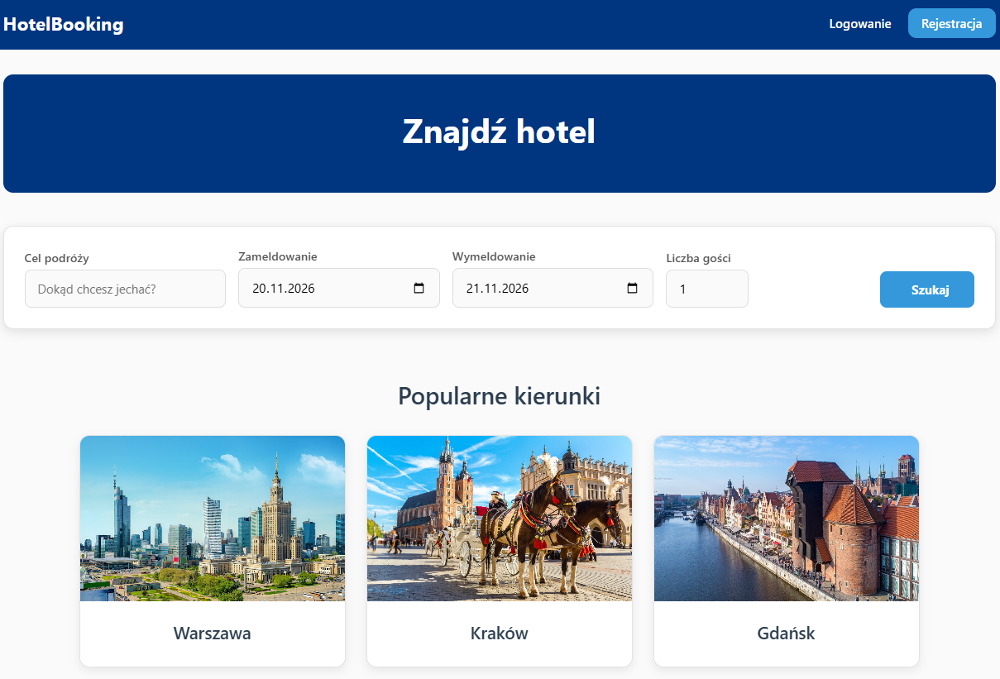
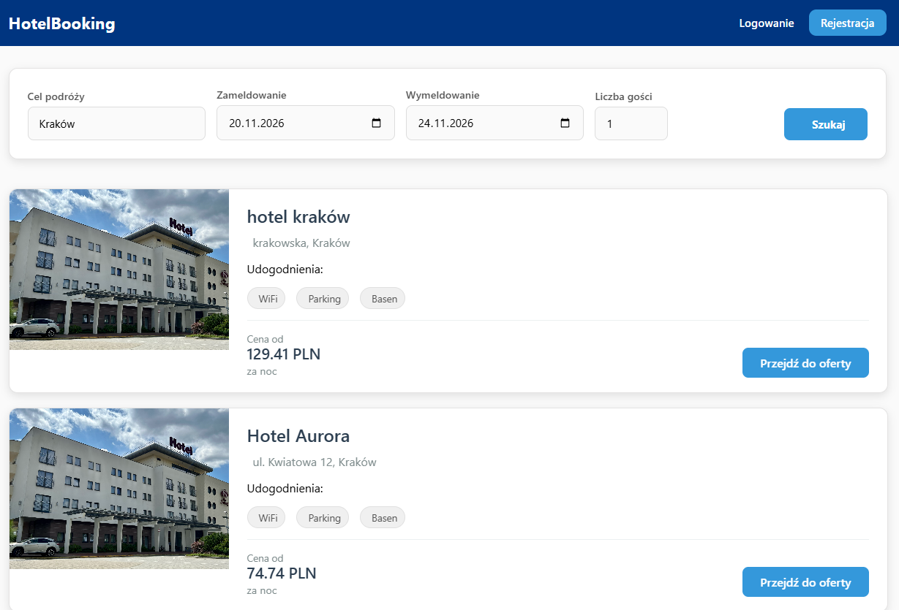
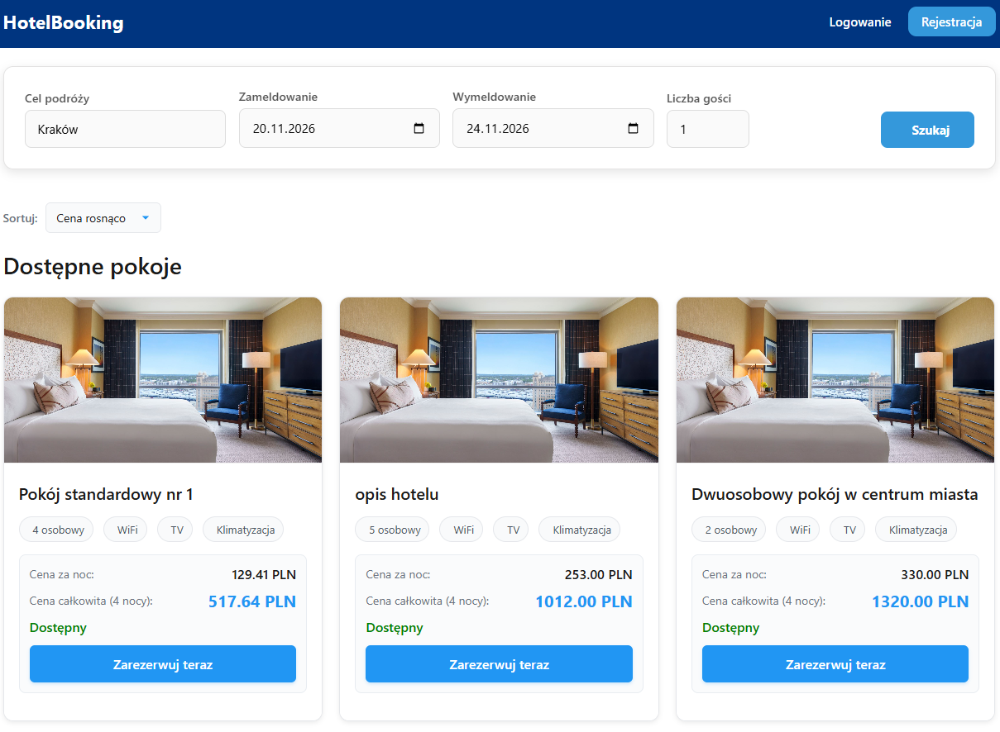
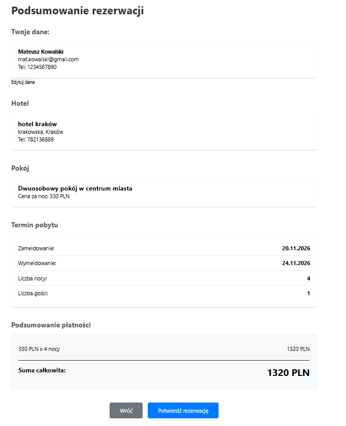
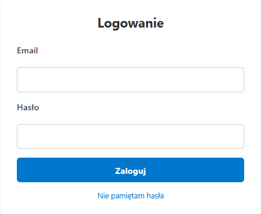
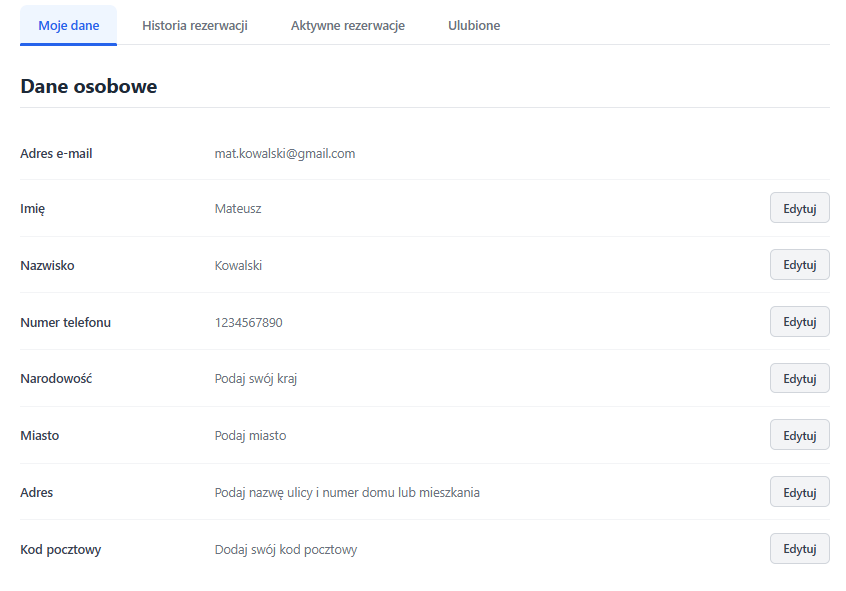
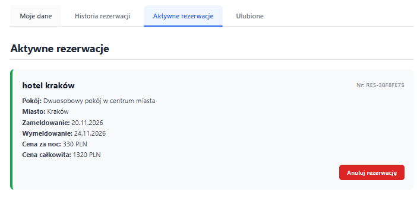
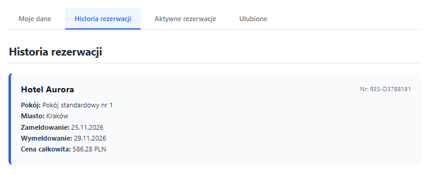
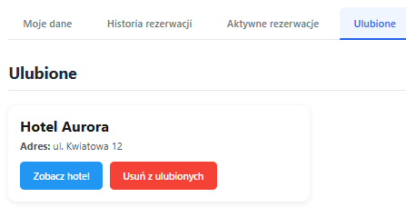

# HotelApp – Frontend

## Project Overview

HotelApp Frontend is a web application for searching and booking hotel accommodations, built with Angular and TypeScript. It provides a user interface for browsing hotels, checking room availability, making reservations, and managing user accounts.

The application is implemented as a Single Page Application (SPA) and communicates with a separate Spring Boot backend through a REST API.

**[Backend Repository](https://github.com/MateuszWrz/HotelAppBackend)**

## Table of Contents

- [Features](#features)
- [Technology Stack](#technology-stack)
- [Application Architecture](#application-architecture)
- [Getting Started](#getting-started)
- [Building and Running the Application](#building-and-running-the-application)
- [Screenshots](#screenshots)
- [Deployment](#deployment)

## Features

### Hotel Search and Browsing

- Search for hotels by destination, check-in and check-out dates, and number of guests.
- Destination autocomplete and date validation.
- Browse popular travel destinations.
- View hotel offers, addresses, amenities, and starting prices.
- Browse available rooms and their guest capacity.
- Sort room offers by price in ascending or descending order.
- View nightly prices and the total cost of a stay.

### Authentication and Account Management

- User registration and login.
- Email-based account activation and activation email resending.
- Password recovery and reset.
- JWT-based authentication through the backend API.
- Route guards for views requiring authentication.

### Reservations

- Select a room and review reservation details before confirmation.
- Display room availability and handle booking conflicts reported by the backend.
- Display the reservation number after a successful booking.
- View active reservations and reservation history.
- Cancel eligible reservations at least two days before check-in, according to backend rules.

### User Profile and Favorites

- View and edit personal information.
- Manage active reservations and browse previous bookings.
- Add and remove favorite hotel offers.
- Access saved hotels from the user profile.

### User Interface

- Responsive layout for desktop and mobile devices.
- Form validation and feedback messages.
- Client-side navigation between application views.

## Technology Stack

| Technology         | Purpose                                             |
| ------------------ | --------------------------------------------------- |
| Angular 14         | Frontend framework and component-based architecture |
| TypeScript 4.8     | Application logic and static typing                 |
| HTML5              | User interface structure                            |
| CSS                | Styling and responsive layouts                      |
| RxJS 7.5           | Observables and asynchronous operations             |
| Angular Router     | Client-side navigation and route guards             |
| Angular Forms      | User input and form validation                      |
| Angular HttpClient | REST API communication                              |
| JWT                | Token-based authentication with the backend         |
| npm                | Dependency management                               |

## Application Architecture

HotelApp follows a three-layer system architecture consisting of a presentation layer, an application layer, and a data layer.



The Angular frontend represents the presentation layer and communicates with the Spring Boot application layer through a REST API. The backend is responsible for business logic, authentication, authorization, reservation validation, and data persistence using PostgreSQL.

### Frontend Architecture

The frontend uses Angular's component-based architecture to separate the user interface, navigation, and API communication.

- **Components** — render application views, display data, and handle user interactions.
- **Services** — communicate with the backend API and provide functionality shared across components.
- **Routing and Guards** — manage client-side navigation and restrict access to selected views.
- **HTTP Interceptor** — attaches JWT bearer tokens to authenticated API requests.
- **Environment Configuration** — defines backend API settings for development and production builds.

### Main Services

| Service              | Responsibility                                     |
| -------------------- | -------------------------------------------------- |
| `AuthService`        | User authentication and account-related operations |
| `HotelService`       | Hotel search and hotel data retrieval              |
| `RoomService`        | Room data retrieval                                |
| `ReservationService` | Reservation-related API operations                 |
| `FavoriteService`    | Management of favorite offers                      |

### API Communication

The frontend exchanges data with the backend using HTTP requests and JSON. Authentication tokens are included in the `Authorization` header as bearer tokens where required. Access control and business rules are enforced by the backend, not by the client-side route guards alone.

## Getting Started

### Prerequisites

- Git
- Node.js and npm compatible with Angular 14
- Access to a running [HotelApp backend](https://github.com/MateuszWrz/HotelAppBackend)

The project's local Angular CLI is installed with its development dependencies. A global Angular CLI installation is not required for the npm commands below.

### Installation

1. Clone the repository:

   ```bash
   git clone https://github.com/mateuszwrzyszcz/HotelAppFrontend.git
   ```

2. Navigate to the project directory:

   ```bash
   cd HotelAppFrontend
   ```

3. Install dependencies using the lockfile:

   ```bash
   npm ci
   ```

4. Start the backend locally by following the [backend documentation](https://github.com/MateuszWrz/HotelAppBackend). Configure the frontend API address in the environment files as described below.

5. Start the development server:

   ```bash
   npm start
   ```

6. Open [http://localhost:4200/](http://localhost:4200/) in your browser.

The development server automatically reloads the application when source files are modified.

### Environment Configuration

The backend API address is configured in the Angular environment files:

```text
src/environments/
├── environment.ts
└── environment.prod.ts
```

- `environment.ts` — development environment configuration.
- `environment.prod.ts` — production environment configuration.

For local execution, set the API address in `environment.ts` to `http://localhost:8081` (assuming the backend uses its default local port). For production builds, set the address in `environment.prod.ts` to a running backend instance. Check the `fileReplacements` settings in `angular.json` to confirm which environment file is used by each build configuration. The previous Render endpoint is no longer available. The backend must allow requests from `http://localhost:4200` through its CORS configuration.

Do not store passwords, private API keys, or other secrets in Angular environment files, as frontend configuration is included in the client-side build.

## Building and Running the Application

### Development Build

To compile the frontend for local use, explicitly select the development configuration:

```bash
npm run build -- --configuration development
```

Make sure the API URL in `environment.ts` points to the running local backend (typically `http://localhost:8081`).

### Production Build

To create an optimized production build, run:

```bash
npm run build -- --configuration production
```

Before building, configure the API URL in `environment.prod.ts`. If testing the production build with a local backend, use its local address here as well. For serving the application at the root URL, ensure the build uses a base href of `/`.

The compiled files are generated in the `dist/` directory. Running a build does not start a web server.

### Running the Compiled Application

After building, serve the compiled files locally:

```bash
npx serve -s dist/hotel-booking-app -l 4200
```

If prompted, confirm installation of the `serve` package. The `-s` option enables SPA routing fallback. If the output directory differs, use the `outputPath` specified in `angular.json`.

Open [http://localhost:4200/](http://localhost:4200/) in your browser. Stop any development server already using port 4200 before running this command.

The backend must be running and correctly configured for the application to provide its full functionality. If requests fail, check the Request URL in the browser's Network tab and verify the backend address and CORS settings.

## Screenshots

The following screenshots demonstrate the main application views and user workflows. The interface is presented in Polish.

### Hotel Search and Booking

#### Home Page

The home page provides a hotel search form and a selection of popular travel destinations. Users can specify their destination, stay dates, and number of guests.



#### Hotel Search Results

The results page displays hotel offers with images, addresses, amenities, and starting prices per night.



#### Hotel Offer and Available Rooms

The hotel offer page presents available rooms, guest capacity, amenities, nightly prices, and the total cost of the selected stay. Users can sort rooms by price and proceed to booking.



#### Reservation Summary

Before confirming a booking, users can review their personal information, selected hotel and room, stay dates, number of guests, and total reservation cost.



### Authentication and Account Activation

#### Login and Registration

Users can create an account, log in, and access password recovery from the login view.

|                   Login                   |                    Registration                     |
| :---------------------------------------: | :-------------------------------------------------: |
|  |  |

#### Email Account Activation

After registration, an activation email is sent to the user. The activation link enables the user to activate the account.


### User Profile and Reservation Management

#### User Profile

Authenticated users can view and edit personal information, including their name, phone number, nationality, and address.



#### Active Reservations

Users can review their active reservations, including booking numbers, hotel and room details, stay dates, and prices. Eligible reservations can be canceled directly from the profile.



#### Reservation History

The reservation history provides access to previous bookings and their details.



#### Favorite Hotels

Users can browse saved hotels, return to hotel offers, and remove entries from their favorites list.



## Deployment

The frontend was previously deployed on GitHub Pages, while the backend was hosted on Render.

Neither service is currently hosted online. To use the full functionality of the application, run both projects locally by following the instructions in this README and the backend documentation.

The frontend and backend are maintained as separate repositories and can be deployed independently.

**Backend repository:** [HotelAppBackend](https://github.com/MateuszWrz/HotelAppBackend)
